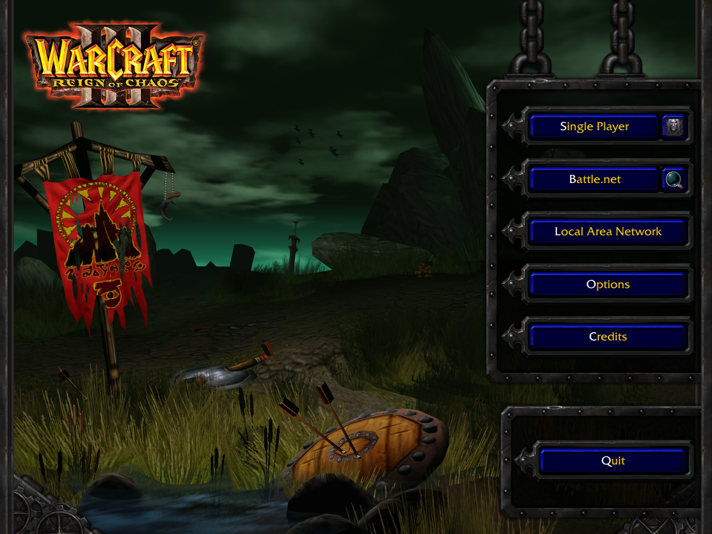
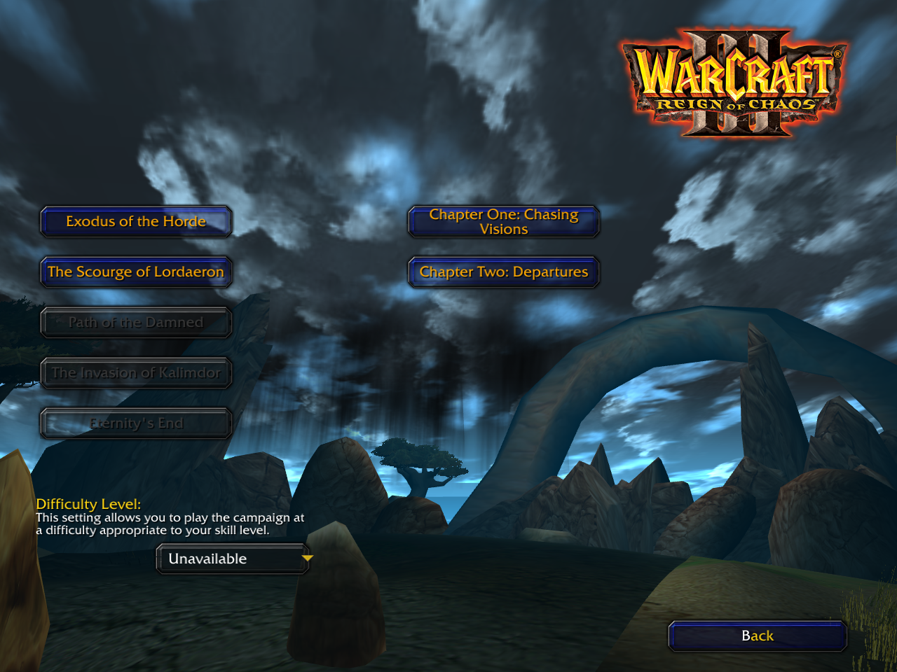
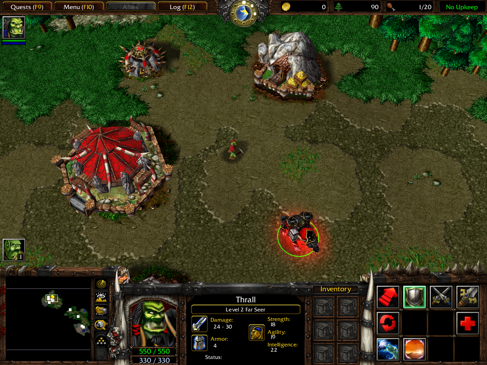
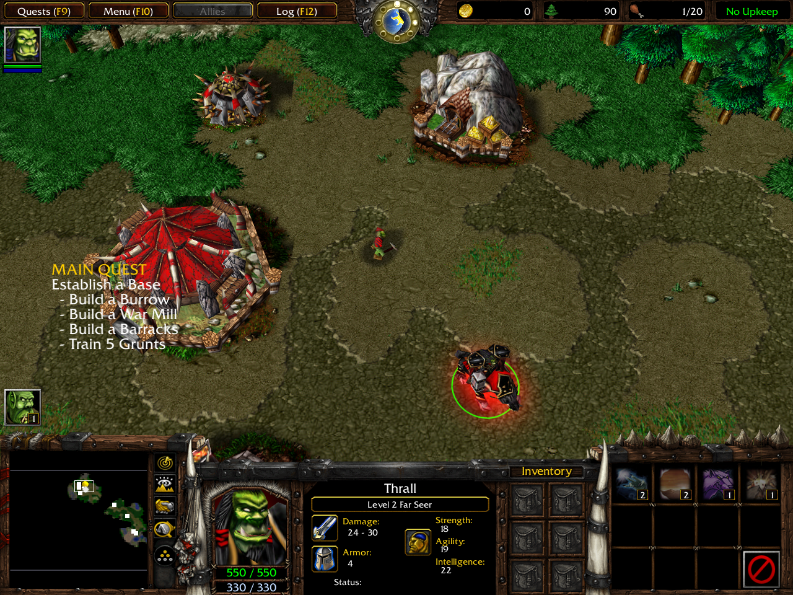
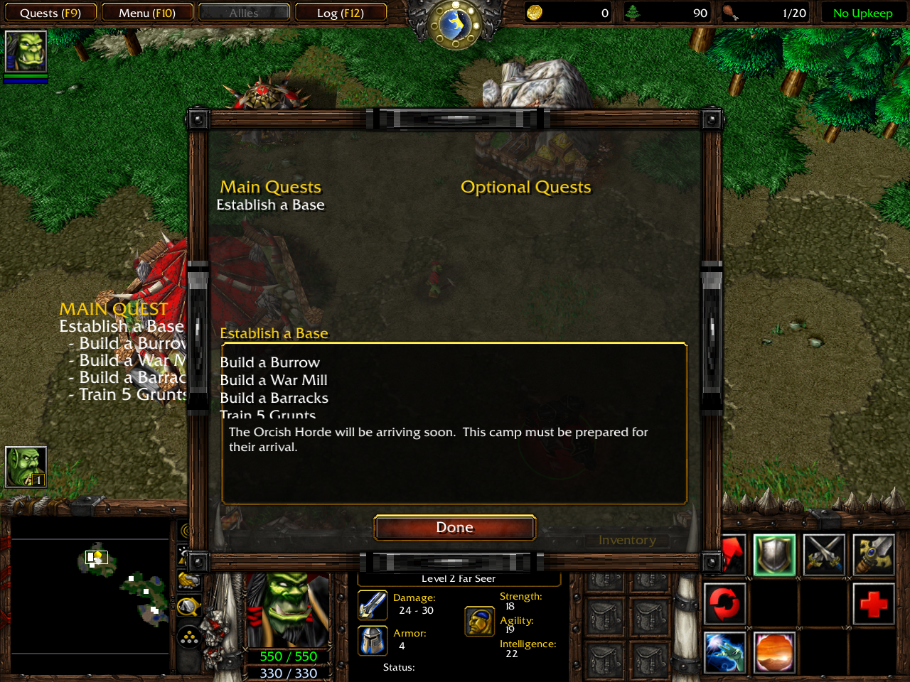

<p align="center">
  
</p>

<p align="center">
  <a href="https://github.com/maci0/peacecraft3/actions/workflows/desktop-builds.yml"></a>
</p>

# PeaceCraft III

PeaceCraft III targets **Warcraft III: The Frozen Throne 1.29b**
(executable version `1.29.2.9231`). It uses Rust and Bevy and reads original
assets from the user's MPQ archives.

- **[PLAN.md](PLAN.md)** for the technical plan, milestones, risks, definition of faithful
- **[TRACKER.md](TRACKER.md)** for the live task tracker, open unknowns, fidelity log
- **[docs/re-notes/](docs/re-notes/)** for reverse-engineering notes, cited by REA evidence id
- **[tools/rea.sh](tools/rea.sh)** runs Reverse Engineer Anything (REA) with
  per-target snapshots

No Blizzard assets are committed. The game reads them from your own install at runtime.
Set `PEACECRAFT3_INSTALL` to choose the installation. If it is unset or
unrecognized, the app tries `PEACECRAFT3_LEGACY_DIR`, then host-specific
paths. The final fallback is the relative path `wc3/game/app`.

## Screenshots

Captured from PeaceCraft III 0.19.0's Bevy renderer on 18 November 2026 using
locally supplied Legacy 1.29.2.9231 game assets. These captures were not
compared with the original client.

**Main menu**



**Campaign and chapter selection**



**Campaign world and command card**



**Hero skill menu**



**Quest dialog**



[Capture details and rendering limits](docs/screenshots/README.md).

## Status

Current release: [0.20.0](docs/releases/0.20.0.md).

The 0.6.0 runs reached authored Victory in Human01 and Human02. See the
[tracker](TRACKER.md) for those run scopes. The
[0.16.0 startup sweep](docs/releases/0.16.0.md) separately covered all 97 shipped
campaign, credits and sub-maps against Legacy 1.29.2.9231. The 0.19.0 release
validates bounded startup and diagnostic replays.
Play beyond startup, continuation, full Save/Load and rendering fidelity remain
in progress.

## Quick start

Set the path to your own Legacy 1.29.2.9231 installation, then run the app:

```sh
export PEACECRAFT3_INSTALL="/path/to/Warcraft III (Legacy)"
cargo run --locked -p peacecraft3
```

The PeaceCraft settings screen opens first. Choose **Main menu** to play the
skippable startup cinematic and enter the game menu. The cinematic uses
`ffmpeg` on `PATH`. If playback cannot start, the app opens the game menu directly.

## Builds and browser demo

- The [Windows and macOS build guide](docs/build-desktop.md) explains the native build
  matrix, packaging and target validation.
- The [browser demo](https://maci0.github.io/peacecraft3-demo/) offers partial
  menus and fullscreen. Import your own local assets. See the
  [import and packaging guide](docs/pages-demo.md) for support limits.

## Contributor notes

The Legacy target and the extracted compatibility tree are separate inputs.
The compatibility tree contains a `1.26.0.6401` Game.dll and serves parser
cross-checks. These versions identify the executables. See the
[artifact evidence](docs/re-notes/glue-coordinate-runtime.md#exact-artifacts)
for archive and installer scope.

Run `cargo test -p pcx-mpq` for archive tests. Local-input checks use these
paths independently of `PEACECRAFT3_INSTALL`.

- Header and table checks skip if `wc3/game/app` is absent. A present tree
  must contain all four archives.
- The decryption check skips if `wc3/game/app/war3.mpq` is absent.
- The Legacy identity check skips if `PEACECRAFT3_LEGACY_DIR` is unset or
  `War3.mpq` is missing or isn't a regular file.
- The file-backed and in-memory archive comparison skips if
  `PEACECRAFT3_LEGACY_DIR` is unset or doesn't name a directory. It fails if
  `War3.mpq` can't be read from that directory.

Run `tools/rea.sh doctor` to check the local analysis tools. The optional
`pcx-blp` `wasm_smoke` example uses `--features local-fixtures` and embeds
`SelectionCircleLarge.blp`, `Footman.mdx` and `misc.tga` from
`crates/pcx-blp/tests/fixtures/`.
Keep the original inputs and compiled example local.
