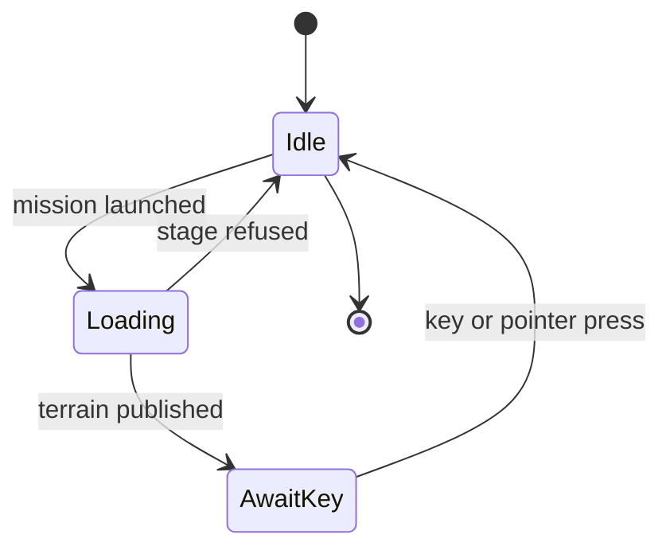

# Campaign loading screen

How the original selects and presents the screen shown while a map loads. Evidence
classes are labelled: **bytes** (shipped archive members), **exe** (static reading of
the Legacy `Warcraft III.exe`, SHA-256
`3f2ed0120d80578bf07e4423296dade1adfb959d59a2d20a7584224559570eed`,
file-offset-to-VA delta `0x401200` in `.rdata`), **runtime** (none yet) and
**inference**. Addresses are VAs in that image.

## Selection (map header to model)

**bytes.** The w3i fields that feed the screen, in file order after the tileset byte
(version 18 Human01 decodes to: background number `2`, text, title, subtitle, data set
`-1`):

| Header field | `MapInfo` field (legacy name) | Gate |
| --- | --- | --- |
| loading background number (`-1` = none) | `extra_u32` | version >= 0x11 |
| custom loading model path | `first_string` | version >= 0x14 |
| loading text | `fog_string` | always |
| loading title | `second_string` | version >= 0x0b |
| loading subtitle | `third_string` | version >= 0x0b |

The names in `MapInfo` are historical; `MapInfo::loading_screen` exposes the
fields under their meaning. `loading_id`, `loading_path` and `loading_strings` are
the data-set selector and the prologue fields, not the loading screen (see
[campaign-data-selection](campaign-data-selection.md)). Text, title and subtitle are
usually `TRIGSTR_nnn` keys resolved through `war3map.wts`.

**bytes.** `UI\WorldEditData.txt` has a `[LoadingScreens]` section: `NumScreens=98`
and records `NN=version,name key,sequence index,model path`. The comment above it
reads: value 0 is the game version in which the screen first appeared, value 1 the
editor display text, value 2 "which animation sequence to use", value 3 the model.
Example: `02=0,WESTRING_LOADINGSCREEN_HUMAN01,0,...\LordaeronBackground.mdl`;
`LordaeronBackground.mdx` has sequences `Human01`, `Human02`, ... so the integer is
a sequence index. `[PrologueScreens]` and `[CampaignScreens]` are other tables in
the same file.

**exe.** `0x70cd70(kind, index, out)` reads one record. The section-name table at
`0xea8944` holds `LoadingScreens`, `PrologueScreens`, `CampaignScreens`; the key is
`%02d` (`0xe8df58`); values 0, 2 and 3 become `out[0]`, `out[1]` and the model path
string, value 1 the name. Kind 2 whose index is not below `CampaignScreens`
`NumScreens` continues into `LoadingScreens`. The profile is `UI\WorldEditData.txt`
(string at `0xea896b`), so the game, not only the editor, reads this table.

**exe.** The screen constructor `0x558c70` reads the map header with `0x703ff0`.
Header `+0x448` (background number) and `+0x44c` (custom path, 260 bytes) choose
the panel at `0x558f8f` to `0x558fb8`: the panel flag at `this+0x214` is 1 when the
number is `>= 0` or the custom path is non-empty, else 0. With the flag set the
background model path is `0x70cd70(0, number, ...)` for a number `>= 0` (sequence
from the table) or the custom path with sequence 0. The model is set on the
`LoadingBackground` sprite and the sequence selected by index (`0x966f20`).
Without it, the melee panel is shown (minimap, map name, game type, player slots)
and the model comes from the skin key `LoadingMeleeBackground` (`UI\war3skins.txt`),
which is outside the campaign case.

**exe.** Title and subtitle are set into `LoadingTitleText` and
`LoadingSubtitleText` from header `+0x550` and `+0x5b1`; the loading text is fitted
by `0x53fba0` and set into `LoadingText`. The fitting algorithm (the `0.17` constant
at `0x55905b`) is not decoded.

## Frames

**bytes.** `UI\FrameDef\Glue\Loading.fdf`: `Loading` (SetAllPoints) contains sprites
`LoadingBackground` (SetAllPoints) and `LoadingBar` (BOTTOMLEFT of `Loading`, y
offset `0.0025`) with child text `LoadingBarText` (BOTTOM, y `0.057`); frame
`LoadingCustomPanel` holds `LoadingTitleText` (width 0.36, TOPRIGHT, x `-0.025`,
y `-0.295`, centred, colour `0.99 0.827 0.0705`), `LoadingSubtitleText` and
`LoadingText` (width 0.36, left-justified); `LoadingMeleePanel` is the melee case.
Fonts and colours come from `StandardTitleTextTemplate`, `StandardLabelTextTemplate`
and `StandardValueTextTemplate` in `StandardTemplates.fdf`.

**exe.** The constructor looks the frames up by those names (`0x8711d0`).

## Progress bar

**bytes.** `UI\war3skins.txt` `LoadingProgressBar=UI\Glues\Loading\LoadBar\LoadBar.mdl`.
`LoadBar.mdx` has two sequences, `Birth` and `Stand`.
GlobalStrings: `LOADING_LOADING` ("L  O  A  D  I  N  G"), `LOADING_PRESS_A_KEY`
("PRESS ANY KEY TO CONTINUE"), `LOADING_WAITING_FOR_PLAYERS`.

**exe.** The constructor loads the skin string `LoadingProgressBar` (`0xe8c808`)
onto the `LoadingBar` sprite. `0x586e10(state)` is the bar state setter: state 0 sets
`LoadingBarText` to `LOADING_LOADING`, installs `0x549c10` as the sequence-time
callback and reads the sequence length into `0x113cb2c`. Globals: `0x113cb24`
displayed progress, `0x113cb28` target progress, `0x113cb2c` sequence length.

The callback (and `0x55d630`, `0x54fcc0`) advance the displayed value once per call:
if `target - displayed > 0.01` (`0xe7e968`) add `0.01`, otherwise add `0.001`
(`0xe8df60`). The sequence time is `min(displayed, 1.0) * length`. The displayed
value therefore trails the target at 0.01 per call and creeps by 0.001 per call
when level, reaching the end without further reports.

**exe.** `0x54fcc0(delta)` is the progress report: for a non-zero delta it snaps
displayed up to the old target when behind, then `target += delta`. It is
registered as the loader callback (`0x7054e0`) and the global pump (`0x4a1b60`).
Loaders call the pump with `0.0` at least every 100 ms of file loading
(`0x48ee04`, `0x4afee0`), which redraws the screen. Non-zero reports are
immediates in the game-start code (`0x479118`..`0x47fc8f` via `0x54e230`): `0.01`,
`0.1`, `0.1`, `0.1`, `0.25`, `0.1` in one path, `0.2`, `0.1`, `0.3`, `0.28` in
another, `0.02`, `0.05` in a third. The paths are not attributed to start
conditions, so the stage weights of one complete load are **not established**.

## Completion

**exe.** On the load-complete event `0x4009007e` the handler `0x572b90`:

1. sets the bar to its end (`0x96cd30(..., 1.0)`);
2. computes elapsed time against the start time stored at `this+0x21c`;
3. compares with the minimum display time at `this+0x220`, computed in the
   constructor as `min(300.0, 3.0 + 0.1 * (len(text) + len(title) +
   len(subtitle)))` (constants at `0xe78344`, `0xe78340`, `0xe8dfe4`);
4. `0x5ad700` is true when the session's provider tag (`session+0x2650`) is
   neither `LOOP` nor `NONE`, which is read here as "network game".

For a custom panel: in a network game with time remaining, `0x58dd40` shows the
press-a-key state with a timer; in a local game `0x58dd40(0)` shows it with no timer.
`0x58dd40` sets state 1, `LoadingBarText` = `LOADING_PRESS_A_KEY`. Input handlers
`0x574940`, `0x575810` (message type `0xd`) and `0x575c80` call `0x56a220` when
state is 1. `0x56a220` releases the load hold (`0x5adb00` on the token created at
`0x5ae5c0`): in a network game it first shows `LOADING_WAITING_FOR_PLAYERS`. The
melee panel skips the key wait.

**inference.** In a single-player campaign map the screen therefore stays up with
the full bar and "PRESS ANY KEY TO CONTINUE" until a key or pointer press, and
gameplay starts only afterwards. The message type `0xd` is read as key-down;
`0x574940` and `0x575c80` as pointer events; their type values are not decoded.

## Recreation mapping

- The screen opens when the mission is launched and the map header is read (the
  original reads the header in the constructor, before the load stages).
- Selection, text, frames, fonts and the bar model come from the selected files.
  The three bar constants (`0.01`, `0.001`, `1.0`) are read from the reviewed image
  at runtime by `ProgressRules::read` and checked to be an ordered ramp. The
  minimum display time is not read or applied: the original uses it only for a
  network game.
- **Recreation choice.** Progress reports come from the recreation's own load
  stages, each worth an equal share (`STAGES` in `campaign_loading.rs`): map bindings
  published, host inputs prepared, script session running, terrain published.
  They are not the original's immediates.
- **Recreation choice.** The bar eases once per presented frame, the closest
  observable to the original's per-update callback.
- **Recreation choice.** The simulation is held (`CampaignRuntime::view_paused`)
  from the launch until a press ends the loaded screen, the stand-in for the
  original's load hold token. The campaign view, input and menu are blocked
  meanwhile.
- **Recreation choice.** Sprite models are drawn without scene lighting, and the
  background sequence loops by the real-time clock; whether the original plays
  these sequences once is not established.
- The post-load bar sequence in state 1 (`[ebp-0x88] = 4`, `0x966c10`) does not map to
  `LoadBar.mdx` (two sequences). The bar holds its end frame; unresolved.
- Not implemented: the melee panel (headers with neither a number nor a model),
  the network wait and timer, the text-fitting routine (`0x53fba0`), map-supplied
  custom loading models (the pre-admission source does not mount the map archive;
  the screen refuses loudly and the mission loads without it), and a loading screen
  for next-level continuation or the browser path, which do not go through the
  chapter launch.

## Load end without a camera, and audio

**exe.** The load-complete event comes from the game start sequence (the stage
reports above), not from a camera: nothing in `0x572b90` or its callers reads a
camera or view state. The recreation therefore ends the load when the session is
published and its terrain is mounted (`CampaignCamera::view_ready`), and cancels it
when startup, admission or the terrain for this load is refused. A map that never
sets a camera ends its screen and waits for the key like any other; whether the
view then draws is the existing camera consumer's behavior.

**exe.** No loading gate on script audio was found. `StartSound` (`0x4ac260`) is
skipped only when `0x5add50` is non-zero, which reads two session counters and the
flag at session `+0x898` (a replay fast-forward predicate, not a loading one);
`PlayThematicMusic` (`0x4a4200`) forwards straight to the music player (`0x5d9170`)
with no condition. The loading screen global (`0x113cb30`) is read only by the
screen's own progress functions. So a sound or music started by `main` plays during
the load in the original's call path, and the recreation keeps that: script audio is
not gated behind the screen. Sounds the script starts from timers or dialogs wait
because the simulation is held. This is static evidence; whether the audio engine
itself is idle during the load was not observed.

## Verification

Static facts above were read from the image's disassembly and the shipped
members listed. Nothing here is a runtime observation of the original.

- Unit tests with synthetic fixtures: table parsing and selection
  (`pcx-play/src/campaign_loading.rs`), header fields (`pcx-map/src/info.rs`), the
  state machine and press handling
  (`peacecraft3/src/campaign_loading_tests.rs`), anchor layout
  (`peacecraft3/src/campaign_loading_view.rs`).
- Explicit local-input gates, which need the Legacy install:
  `PEACECRAFT3_LEGACY_DIR` for
  `campaign_loading::tests::the_selected_image_supplies_the_bar_constants`;
  `PCX_NATIVE_CHAPTER_INSTALL` for
  `native_campaign::tests::selected_install_every_indexed_map_builds_its_loading_screen`.
  The second builds the screen for every indexed map of both editions (42 RoC, 37
  TFT) through the real archives, FDF, fonts, models and textures, in a bare world.
- Offscreen render, ignored test
  `native_campaign::tests::selected_chapter_loading_screen_renders_offscreen`
  (`PCX_NATIVE_CHAPTER_*`, `PCX_LOADING_CAPTURE_DIR`, a Vulkan adapter, no window):
  Human01 renders the Lordaeron map background, the title ("Chapter One"), the
  subtitle, the paragraph, the bar border and glass, `L O A D I N G`, and a fill that
  follows the bar's progress (empty at no stages, about half at two). The capture
  target is plain `Rgba8UnormSrgb`, not the menu's colour working space, so colour is
  not qualified. The frames are local files under `.scratch/` and are not committed.
- **Resolved: black rectangles.** An earlier capture, taken before `pcx-blp` honoured
  the fourth JPEG component regardless of `alpha_bits`, drew the emblem and location
  icons on opaque black rectangles. Both textures are JPEG-content BLP1 files with
  header alpha bits 0 whose fourth component is real coverage (the emblem has partial
  alpha at 52,006 of 65,536 pixels, 31,409 fully transparent); their layers are filter
  mode 2 (Blend), unshaded. Materials, blend mode and uploaded image alpha were
  checked on the loading screen path and were correct. With the fixed decoder the
  same render shows the emblem and icons blended over the map. Regression gate:
  `pcx-blp` `an_alpha_less_header_still_decodes_its_fourth_component_as_alpha`
  (`PEACECRAFT3_LEGACY_DIR`). The layers' static alpha tracks and the sequence
  clock were not compared with the original.
- Not compared against a capture of the original loading screen.

